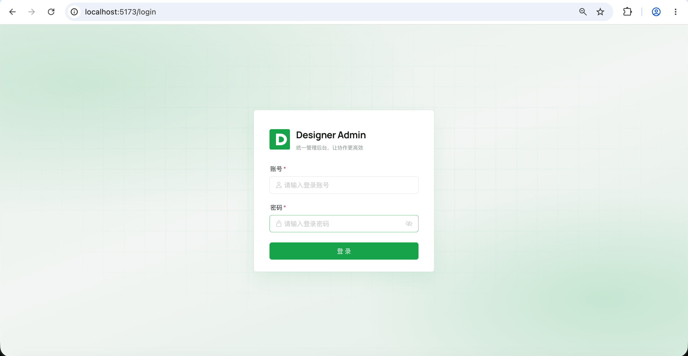
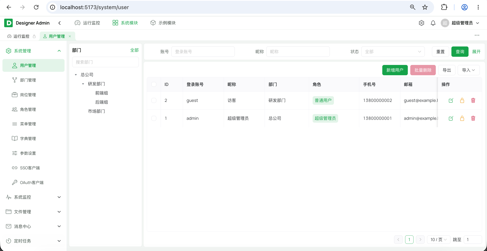
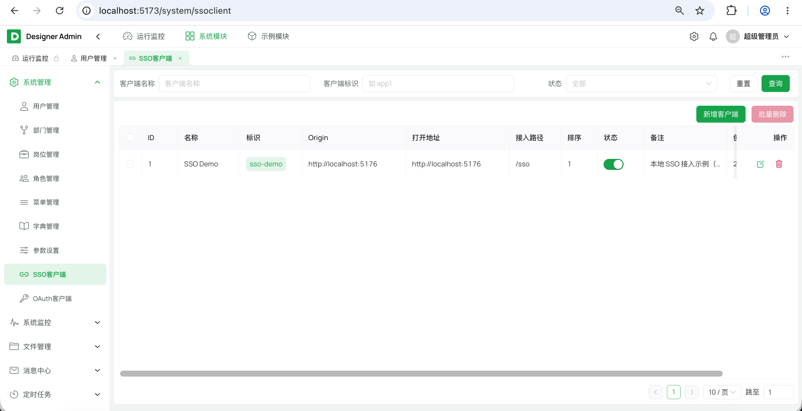
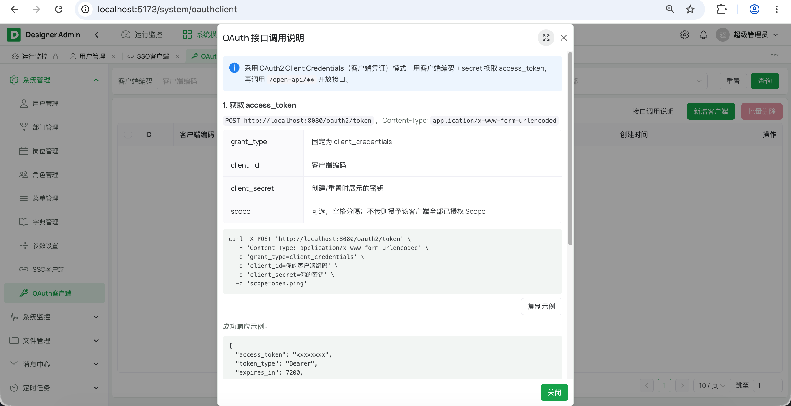
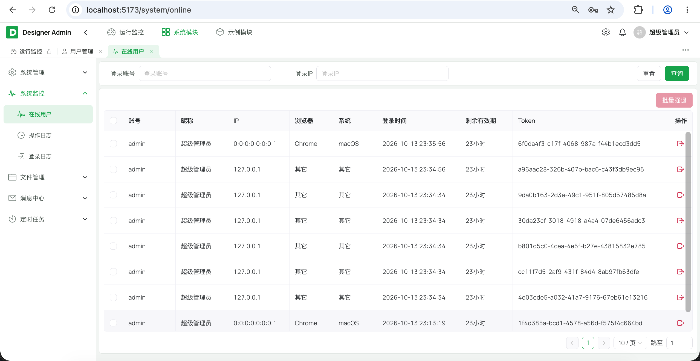
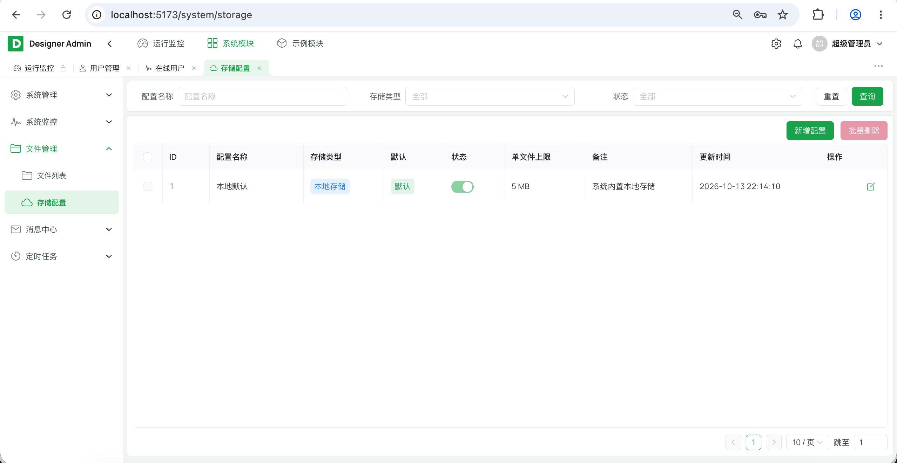
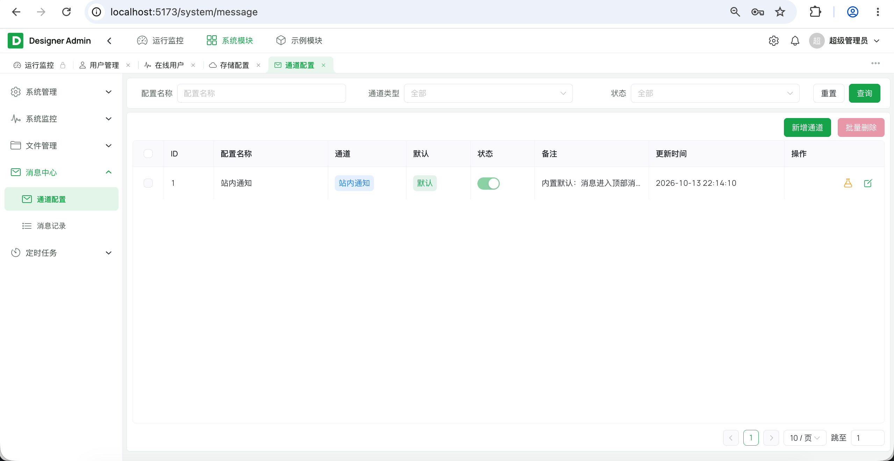
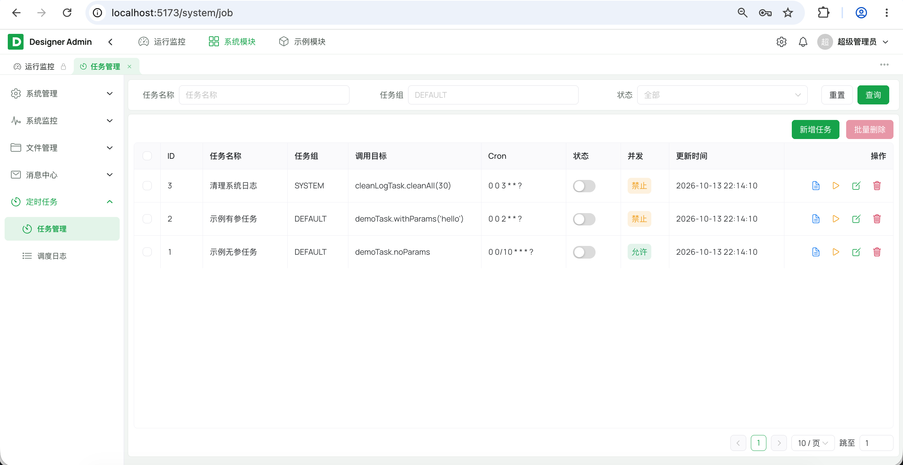

# Designer Admin · Solon + Vue3 后台管理脚手架

[](LICENSE)
[](https://adoptium.net/temurin/releases/)
[](https://solon.noear.org/)
[](https://vuejs.org/)
[](https://gitee.com/rainterm/designer-admin-solon)

一套**开箱即用**的企业级后台管理系统脚手架：后端 **Solon 全家桶 + MyBatis-Plus**，前端 **Vue 3 + Naive UI + Vite**，内置 **RBAC 权限模型**与完整的基础能力，克隆即可开发。

**核心特点**

- **开箱即用**：登录鉴权、动态路由、权限控制、数据字典、操作日志、定时任务等基础能力齐全，免去重复造轮子
- **多模块解耦**：采用 `common / framework / module-* / server` 分层，二次开发只需**新增业务模块**，不污染脚手架核心
- **可插拔扩展（Provider 扩展点）**：消息通道、文件存储等能力面向接口编程，实现类自带 `type()` 与配置字段（`configFields()`）自描述，注册为 Solon 组件后由注册表自动发现、按 `type` 装配
  - 消息通道 `MessageChannelProvider`：内置站内信 / 邮件，可扩展短信、钉钉、微信、飞书等
  - 文件存储 `FileStorageProvider`：内置本地 / S3 兼容，可扩展 OSS、COS、MinIO 等
- **RBAC 权限模型**：用户 - 角色 - 菜单三级，菜单支持目录 / 菜单 / 按钮，按钮即权限标识（如 `system:user:add`）
- **代码精简、前端统一封装**：列表页由 `SearchBar` + `PageTable` + `Dialog` 等公共组件与 `usePagination` / `useFormDialog` / `useBatchDelete` 等组合式函数拼装，几十行即可完成一个 CRUD；全局样式变量与主题统一，无需逐个页面调样式
- **多端接入**：区分 `/admin-api` 管理端、`/app-api` 前台公开、`/open-api` 第三方开放接口，并内置 **SSO 单点登录**与 **OAuth2 开放接口**
- **企业级能力**：消息通知（站内信 SSE）、Quartz 动态定时任务、EasyExcel 导入导出、`@Sensitive` 字段脱敏、文件上传校验与落库
- **规范统一**：统一响应体、全局异常、分页封装、字段自动填充、逻辑删除、跨域，前后端约定详见[开发规范](docs/开发规范.md)

## 目录

- [在线演示](#在线演示)
- [界面预览](#界面预览)
- [快速开始](#快速开始本地开发)
- [内置能力](#内置能力)
- [技术栈](#技术栈)
- [目录结构](#目录结构)
- [文档](#文档)
- [常见问题（FAQ）](#常见问题faq)
- [Roadmap](#roadmap)
- [贡献与反馈](#贡献与反馈)
- [许可证](#许可证)

## 在线演示

> 🚧 演示站点准备中，欢迎先按 [快速开始](#快速开始本地开发) 本地体验。

## 界面预览

















## 快速开始（本地开发）

### 0. 环境要求

| 组件 | 版本 | 说明 |
|---|---|---|
| JDK | **25+** | 后端编译与运行（`maven.compiler.release=25`） |
| Maven | 3.9+ | 后端构建 |
| Node.js | 18+（推荐 22） | 前端构建 |
| pnpm | 10.x | 前端包管理（`packageManager: pnpm@10.33.0`） |
| MySQL | 8 | 数据库 |
| Redis | 7 | Sa-Token 会话与 SSO 票据存储（**必需**） |

> 一键检查 / 安装以上环境：`cd deploy && ./install-env.sh --check`（去掉 `--check` 即安装）。

### 1. 准备 MySQL 与 Redis

连接信息在 `designer-server/src/main/resources/app.yml`，
已支持环境变量覆盖（`DB_HOST/DB_PORT/DB_USER/DB_PASSWORD/DB_NAME`、`REDIS_HOST/REDIS_PORT/REDIS_PASSWORD/REDIS_DB`）。

### 2. 初始化数据库

> 脚本为**破坏性初始化**（`DROP TABLE` 重建 + 插入种子数据），仅首次或需要重置时执行，勿对有数据的库重复运行。

```bash
# 交互式：按提示输入连接信息，回车使用默认值（已用环境变量提供的项会跳过；数据库名默认 designer_admin，可自定义）
bash sql/init/mysql/00-run-init.sh

# 免交互（CI / 脚本）：直接通过环境变量传入
DB_HOST=127.0.0.1 DB_PORT=3306 DB_USER=root DB_PASSWORD=root DB_NAME=designer_admin bash sql/init/mysql/00-run-init.sh
```

### 3. 启动后端

在 IDE 里运行 `com.designer.admin.DesignerApp`（模块 `designer-server`），或命令行：

```bash
# 在仓库根目录
mvn -pl designer-server -am -DskipTests clean package
java -jar designer-server/target/designer-server.jar
```

默认监听 `http://localhost:8080`，健康检查 `GET /admin-api/system/health`。Demo 探测：`GET /admin-api/demo/ping`（需登录）。

### 4. 启动前端

> 需要 pnpm：`corepack enable pnpm`（Node 16.13+ 内置）或 `npm i -g pnpm`。

```bash
# 管理后台
cd designer-ui/admin-web
pnpm install
pnpm run dev      # http://localhost:5173，/admin-api 代理到 8080
pnpm run build    # 产出 dist/
```

### 默认账号

**注意**：以下为初始化种子数据中的演示账号，仅用于本地体验；部署到生产环境前请务必修改密码或删除该账号。

| 账号 | 密码 | 角色 |
|---|---|---|
| admin | admin123 | 超级管理员（全部权限） |
| guest | guest123 | 普通用户（只读示例） |

## 内置能力

### 认证与权限

- **登录鉴权**：Sa-Token，token 放 `Authorization` 头，会话存 Redis（可集群共享）；滑块验证码（AJ-Captcha，失败达阈值才出现，凭据一次性）与登录失败锁定；`@RateLimit` 再按 IP 给登录接口兜一层频控（挡「换用户名扫」的撞库 / 爆破）
- **RBAC**：用户 - 角色 - 菜单三级（`sys_user_role` / `sys_role_menu`）；菜单含目录 / 菜单 / 按钮三类，按钮即权限标识（`system:user:add`）
- **动态路由**：登录后拉取 `/admin-api/system/auth/routers`，前端按用户权限注册路由与菜单
- **权限控制**：后端 `@SaCheckPermission`，前端 `v-perm` 指令（另有 `@SaCheckLogin` / `@SaIgnore`）
- **在线用户**：查看登录会话，支持单个 / 批量踢下线

### 组织与基础数据

- **组织**：用户、部门树、岗位（`sys_post` + `sys_user_post` 关联）
- **角色与菜单**：角色授权（分配菜单权限）、菜单树（目录 / 菜单 / 按钮）
- **数据字典**：类型 + 数据（`sys_dict_type` / `sys_dict_data`），前端按需取用
- **系统参数**：`sys_config`，支持参数刷新到缓存

### 文件与消息

- **文件存储**：可插拔 Provider（内置本地 / S3 兼容），类型 / 大小 / 路径穿越校验，上传元数据落 `sys_file`，后台可切换存储配置（`sys_storage_config`）
- **附件上传**：前端 `AttachmentUploader` 组件复用上传 / 回显 / 删除
- **消息通知**：消息通道配置（`sys_message_config`）、发送记录（`sys_message_record`）、站内信 SSE 实时推送 + 未读数 / 全部已读；内置站内信 / 邮件通道，可扩展短信等

### 日志、监控与任务

- **应用日志**：Solon + Logback，控制台与文件双输出；文件按「天 + 单文件大小」滚动（`maxFileSize` 默认 10 MB），`maxHistory` 默认保留 7 天、`totalSizeCap` 上限 1 GB（配置项 `solon.logging.appender.file.*`）
- **操作日志**：`@OperLog` 异步落库（`sys_oper_log`），记录标题 / 业务类型 / 参数 / 耗时
- **登录日志**：账号 / IP / 浏览器 / 系统 / 结果（`sys_login_log`）
- **服务监控**：CPU / 内存 / JVM / 磁盘等系统信息（`GET /admin-api/system/monitor/server`），首页仪表盘展示
- **定时任务**：Quartz 动态任务（cron / 调用目标 / 并发策略）+ 执行日志（`sys_job` / `sys_job_log`）

### 接口与开放

- **接口分层**：`/admin-api` 管理端（登录态）、`/app-api` 前台公开（默认免登录）、`/open-api` 第三方开放接口（OAuth2 + Scope）、`/oauth2/token` 令牌端点（详见 [开发规范](docs/开发规范.md#接口路径约定)）
- **单点登录（SSO）**：跨应用免二次登录；后台维护 SSO 客户端白名单（标识 / 允许 Origin / 打开地址 / 接入路径，`sys_sso_client`），登录端签发一次性票据（Redis，默认 60s，可配 `designer.sso.ticket-ttl`），目标端换取同一会话，票据用后即删（接入文档与案例代码见 [docs/SSO.md](docs/SSO.md)、[designer-ui/sso-demo](designer-ui/sso-demo)）
- **开放接口（OAuth2）**：Client Credentials 令牌端点 `POST /oauth2/token`（支持 `client_id/client_secret` 或 Basic Auth）；`/open-api/**` 按路径匹配 Scope（`sys_oauth_scope`）校验 access_token，缺少授权 scope 返回 403；后台可管理 OAuth2 客户端与开放 Scope（`sys_oauth_client` / `sys_oauth_client_scope`）

### 前端体验与通用能力

- **布局与主题**：7 种布局（垂直 / 双列菜单 / 水平 / 侧边导航 / 混合垂直 / 混合双列 / 内容通栏）与主题色可在偏好设置中实时切换并持久化
- **多页签**：`TagsView` 页签导航、路由 `PageLoading`、`MessageInbox` 站内信入口
- **个人中心**：资料、头像上传、改密
- **导入导出**：EasyExcel（用户、字典类型 / 数据），带模板下载与导入
- **字段脱敏**：`@Sensitive` 序列化脱敏（手机号 / 邮箱 / 密码等）
- **统一规范**：响应体 `{code,msg,data}`、全局异常、分页封装（单页上限 500）、字段自动填充、逻辑删除、全表更新/删除防护、跨域
- **示例模块**：`designer-module-demo` 演示一个业务模块的最小闭环（`demo-api` / `demo-service` + 前端 `modules/demo`），可复制后改包名开启新模块

## 技术栈

后端为 **Solon 全家桶**：框架、校验、日志、JSON、鉴权、密码加密全部来自 Solon / Sa-Token 生态。

| 层 | 选型 | 版本 |
|---|---|---|
| 运行时 | JDK | 25 |
| 后端框架 | Solon | 4.1.0 |
| ORM | MyBatis-Plus（Solon 插件） | 3.5.17 |
| 多表查询 | MyBatis-Plus-Join | 1.5.9 |
| 鉴权 | Sa-Token（Solon 插件） | 1.46.0 |
| 密码加密 | Sa-Token 自带 BCrypt | 内置 |
| JSON | snack4 | Solon 4.x 内置 |
| 定时任务 | Quartz | 2.5.0 |
| 导入导出 | EasyExcel | 4.0.3 |
| 数据库 | MySQL | 8 |
| 缓存/会话 | Redis | 7 |
| 前端框架 | Vue 3 | 3.5 |
| UI 组件库 | Naive UI | 2.45 |
| 构建 | Vite | 8 |
| 状态管理 | Pinia | 4 |

## 目录结构

```
designer-admin/
├── pom.xml                         # Maven 父工程
├── designer-common/                # 通用：R / BaseEntity / 异常 / 工具 / 注解
├── designer-framework/             # 框架层与扩展接口（鉴权/限流/验证码/日志/任务/存储/消息），禁止依赖 system
├── designer-module-system/         # RBAC（system-api / -service）
├── designer-module-demo/           # 示例（demo-api / -service）
├── designer-server/                # 启动组装：DesignerApp + app.yml + Solon 胖包
│   └── src/main/resources/app.yml
├── designer-ui/                    # 前端工程
│   ├── shared/captcha/             # 多前端共用的滑块验证码源码（组件 + 线协议工具）
│   ├── admin-web/                  # 管理后台（Vue3 + Naive UI）
│   │   └── src/
│   │       ├── api/                # 壳层：request / auth / monitor
│   │       ├── layout/ router/ store/ views/{login,dashboard,profile,error}/
│   │       └── modules/
│   │           ├── system/         # 系统管理 api + views
│   │           └── demo/           # 示例模块 api + views
│   └── sso-demo/                   # SSO 接入示例（Vue3 + Vite）
├── sql/
│   └── init/mysql/                 # 按模块文件夹分类的初始化 SQL
│       ├── 00-run-init.sh          # 入口：_base → system/demo
│       ├── _base/database.sql      # 建库
│       ├── system/{schema,data}.sql
│       └── demo/data.sql
├── docs/                           # 开发规范等文档
└── deploy/                         # Docker 部署
```

## 文档

| 文档 | 说明 |
|---|---|
| [docs/开发规范.md](docs/开发规范.md) | 前后端编码约定、模块依赖方向，以及**新增业务模块**的步骤 |
| [docs/SSO.md](docs/SSO.md) | 单点登录接入流程与三步接入指引 |
| [deploy/README.md](deploy/README.md) | 生产环境 Docker 部署（数据库与应用分开部署） |
| [designer-module-demo/README.md](designer-module-demo/README.md) | 业务模块模板与跨模块调用约定 |
| [designer-module-system/README.md](designer-module-system/README.md) | 系统模块结构说明 |
| [designer-ui/sso-demo/README.md](designer-ui/sso-demo/README.md) | SSO 客户端示例工程 |

## 常见问题（FAQ）

**Q：怎么新增一个业务模块？**
复制 `designer-module-demo` 作为模板，按 [开发规范 · 二次开发](docs/开发规范.md#二次开发新增业务模块) 的 5 步操作，全程不需要改 `common` / `framework` / `system`。

## Roadmap

- [ ] 待规划

## 贡献与反馈

欢迎提交 Issue 与 PR：

1. Fork 本仓库并从 `main` 切出特性分支
2. 遵循 [开发规范](docs/开发规范.md) 的编码与提交约定
3. 提交 PR 前请确保 `mvn -pl designer-server -am -DskipTests package` 与 `pnpm run build` 均通过
4. PR 描述请说明动机、改动范围与验证方式

## 生产环境部署（Docker）

数据库与应用**分开**部署：本机用 JDK / Maven / Node 打包后，再打成运行镜像。

```bash
cd deploy
./install-env.sh          # 检查并安装 Docker / JDK 25 / Maven / Node
cp .env.example .env && vim .env
./deploy-db.sh            # 仅启动 MySQL + Redis（不自动建表）
cd .. && bash sql/init/mysql/00-run-init.sh && cd deploy   # 手动初始化数据库表（首次/重置）
./deploy-app.sh           # 父工程 Maven 打包 + 构建镜像 + 启动 Server / Web
```

可选：`./deploy-minio.sh` 一键起本地 MinIO（S3 兼容存储，`9000` / `9001`）。

浏览器访问：
- 管理后台 `http://<IP>:<APP_PORT>`（默认 80）

完整说明见 [deploy/README.md](deploy/README.md)。

## 许可证

本项目基于 [MIT License](LICENSE) 开源，可自由用于商业项目。
